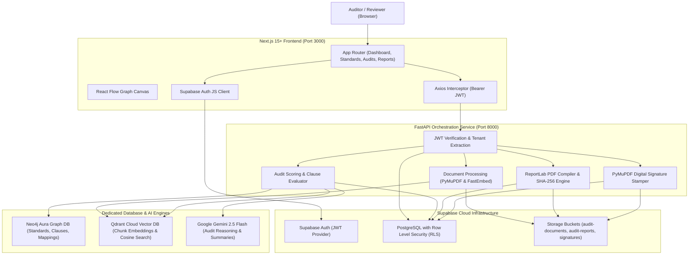

# Architecture Overview — Auditor AI Twin

The **Auditor AI Twin** is designed with a strict Separation of Concerns, ensuring multi-tenant isolation, verifiable audit trails, and zero direct exposure of proprietary AI and graph backends to the browser.

---

## 1. System Architecture Diagram

---

## 2. Core Architectural Principles

1. **Supabase as Single Source of Truth**:
   - Manages users, organizations, memberships, audit metadata, findings, reports, signatures, and immutable audit logs.
   - All tenant access is protected via PostgreSQL Row Level Security (RLS) policies.

2. **Neo4j as Source of Knowledge Truth**:
   - Represents the ISO standard ontology: Standards, Clauses, Requirements, EvidenceTypes, AuditQuestions, and Risks.
   - Manages hierarchical relationships (`PARENT_OF`) and cross-standard equivalences (`MAPS_TO`).

3. **Qdrant for Isolated Semantic RAG**:
   - Dense vector storage (384 dimensions) generated locally using ONNX `BAAI/bge-small-en-v1.5`.
   - Tenant isolation enforced on every query via payload filters (`organization_id`, `audit_id`).

4. **Gemini 2.5 Flash as Cognitive Auditor**:
   - Assesses clause conformance by contrasting Neo4j clause requirement text with retrieved Qdrant document excerpts.
   - Synthesizes findings, gap analyses, and recommendations without hallucination.

5. **Cryptographic Proof & Immutable Signatures**:
   - Report finalization computes a SHA-256 checksum over the compiled PDF bytes.
   - Any modification after signing breaks the SHA-256 verification on `/verify/[reportId]`.
