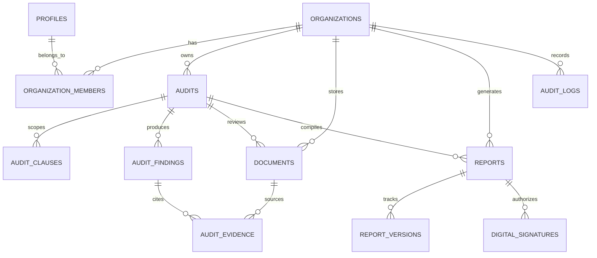

# Database Schema & Multi-Tenant Model

The relational persistence layer is implemented in Supabase PostgreSQL with strict multi-tenancy and Row Level Security (RLS).

---

## 1. Relational Entity Relationship Diagram

---

## 2. Table Specifications

### `organizations`
- `id` (UUID PK): Unique organization ID
- `name` (TEXT): Legal business name of the audited facility or accreditation body
- `created_at` (TIMESTAMPTZ)
- `updated_at` (TIMESTAMPTZ)

### `profiles`
- `id` (UUID PK): User profile ID
- `auth_user_id` (UUID FK -> `auth.users`): Supabase Auth foreign key
- `full_name` (TEXT): Auditor's legal name
- `email` (TEXT): Auditor email
- `created_at`, `updated_at` (TIMESTAMPTZ)

### `organization_members`
- `id` (UUID PK)
- `organization_id` (UUID FK -> `organizations.id`)
- `user_id` (UUID FK -> `profiles.id`)
- `role` (TEXT): Allowed roles: `admin`, `auditor`, `reviewer`, `viewer`

### `audits`
- `id` (UUID PK)
- `organization_id` (UUID FK -> `organizations.id`)
- `name` (TEXT): Engagement name
- `standard_code` (TEXT): e.g. `ISO/IEC 17025`
- `standard_version` (TEXT): e.g. `2017`
- `status` (TEXT): `draft`, `processing`, `under_review`, `approved`, `signed`, `archived`
- `overall_score` (NUMERIC): Weighted score (0-100)
- `created_by` (UUID)
- `created_at`, `updated_at`, `completed_at` (TIMESTAMPTZ)

### `documents`
- `id` (UUID PK)
- `organization_id` (UUID FK -> `organizations.id`)
- `audit_id` (UUID FK -> `audits.id`)
- `file_name` (TEXT): Name of source PDF
- `storage_path` (TEXT): `{organization_id}/{audit_id}/{filename}` in Supabase Storage
- `mime_type` (TEXT): `application/pdf`
- `file_size` (BIGINT): File size in bytes
- `processing_status` (TEXT): `pending`, `processing`, `completed`, `failed`
- `page_count` (INTEGER)
- `file_hash` (TEXT): SHA-256 digest of source PDF
- `uploaded_by` (UUID)
- `created_at` (TIMESTAMPTZ)

### `audit_clauses`
- `id` (UUID PK)
- `organization_id` (UUID FK)
- `audit_id` (UUID FK)
- `standard_code` (TEXT)
- `standard_version` (TEXT)
- `clause_id` (TEXT): Qualified ID (e.g. `ISO17025:2017:4.1`)
- `neo4j_node_id` (TEXT)
- `status` (TEXT): `pending`, `evaluated`
- `created_at` (TIMESTAMPTZ)

### `audit_findings`
- `id` (UUID PK)
- `organization_id` (UUID FK)
- `audit_id` (UUID FK)
- `audit_clause_id` (UUID FK)
- `status` (TEXT): `compliant`, `partially_compliant`, `non_compliant`, `not_applicable`, `needs_review`
- `ai_status` (TEXT)
- `auditor_status` (TEXT)
- `confidence` (NUMERIC): AI assessment confidence (0.00 - 1.00)
- `summary` (TEXT): Summary statement of the finding
- `reasoning` (TEXT): Detailed gap analysis from AI twin
- `missing_evidence` (TEXT): Deficiencies identified
- `recommendation` (TEXT): Actionable remediation instructions
- `ai_generated` (BOOLEAN): Defaults to `true`
- `reviewed_by` (UUID)
- `reviewed_at` (TIMESTAMPTZ)
- `created_at`, `updated_at` (TIMESTAMPTZ)

### `audit_evidence`
- `id` (UUID PK)
- `organization_id` (UUID FK)
- `audit_id` (UUID FK)
- `finding_id` (UUID FK)
- `document_id` (UUID FK)
- `page_number` (INTEGER)
- `section_title` (TEXT)
- `text_excerpt` (TEXT): Direct quotation from the document
- `qdrant_point_id` (TEXT)
- `similarity_score` (NUMERIC)
- `created_at` (TIMESTAMPTZ)

### `reports` & `report_versions`
- `reports`:
  - `id` (UUID PK)
  - `organization_id` (UUID FK)
  - `audit_id` (UUID FK)
  - `status` (TEXT): `draft`, `finalized`, `signed`
  - `current_version` (INTEGER): Default `1`
  - `finalized_at` (TIMESTAMPTZ)
- `report_versions`:
  - `id` (UUID PK)
  - `report_id` (UUID FK)
  - `version` (INTEGER)
  - `content` (JSONB): Contains executive summary, methodology, findings, and checklist
  - `created_by` (UUID)
  - `created_at` (TIMESTAMPTZ)

### `digital_signatures`
- `id` (UUID PK)
- `organization_id` (UUID FK)
- `report_id` (UUID FK)
- `report_version` (INTEGER)
- `signer_user_id` (UUID)
- `signer_name` (TEXT)
- `signer_role` (TEXT)
- `signature_type` (TEXT): `drawn`, `uploaded`
- `signature_storage_path` (TEXT): Path in `signatures` bucket
- `report_sha256` (TEXT): Cryptographic digest of the finalized report
- `signed_at` (TIMESTAMPTZ)
- `ip_address` (TEXT)
- `user_agent` (TEXT)

### `audit_logs`
- Append-only audit trail logging all lifecycle events (`document_uploaded`, `audit_started`, `finding_accepted`, `finding_rejected`, `report_finalized`, `report_signed`).
