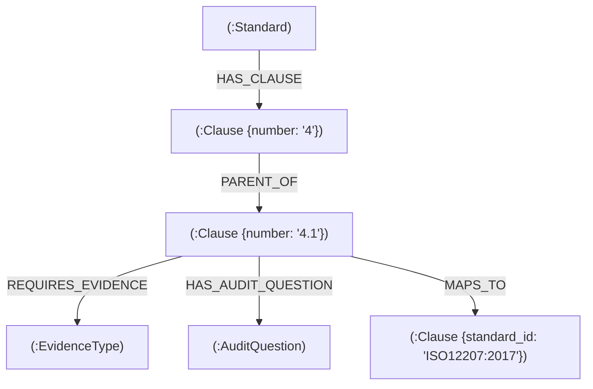

# Neo4j Knowledge Graph — Standards Ontology

The ISO Standards Knowledge Graph is housed in **Neo4j Aura** (`neo4j+ssc://30b20a56.databases.neo4j.io`) and models requirements, evidence types, questions, and cross-standard equivalences.

---

## 1. Graph Model



---

## 2. Node Types & Attributes

| Node Label | Key Attributes | Description |
|---|---|---|
| `Standard` | `id`, `code`, `version`, `title`, `status` | High-level standard entity (e.g. `ISO17025:2017`, `ISO12207:2017`, `ISO15504:2004`) |
| `Clause` | `id`, `number`, `title`, `summary`, `standard_id` | Granular requirement clause (e.g. `ISO17025:2017:4.1 Impartiality`) |
| `EvidenceType` | `id`, `name`, `description` | Formal evidentiary artifact required (e.g. `Impartiality Risk Assessment`, `Calibration Certificate`) |
| `AuditQuestion` | `id`, `question` | Inquisitive check applied by the auditor or LLM |
| `Risk` | `id`, `description`, `severity` | Potential compliance vulnerability |

---

## 3. Relationships & Cypher Queries

### Hierarchy Retrieval
```cypher
MATCH (s:Standard {id: $standard_id})-[:HAS_CLAUSE]->(c:Clause)
OPTIONAL MATCH (c)-[:PARENT_OF*]->(sub:Clause)
RETURN c, collect(DISTINCT sub) as subclauses
ORDER BY c.number
```

### Full Clause Graph for React Flow
```cypher
MATCH (c:Clause {id: $clause_id})
OPTIONAL MATCH (c)<-[:HAS_CLAUSE|PARENT_OF]-(parent)
OPTIONAL MATCH (c)-[:PARENT_OF]->(child:Clause)
OPTIONAL MATCH (c)-[:REQUIRES_EVIDENCE]->(ev:EvidenceType)
OPTIONAL MATCH (c)-[:HAS_AUDIT_QUESTION]->(aq:AuditQuestion)
OPTIONAL MATCH (c)-[:MAPS_TO]->(mapped:Clause)
RETURN c,
    collect(DISTINCT parent) as parents,
    collect(DISTINCT child) as children,
    collect(DISTINCT ev) as evidence_requirements,
    collect(DISTINCT aq) as audit_questions,
    collect(DISTINCT mapped) as cross_standard_mappings
```

### Cross-Standard Equivalence
When auditing an organization holding dual accreditations (e.g. ISO 17025 Testing Lab + ISO 12207 Software Quality System):
```cypher
MATCH (c1:Clause {id: 'ISO17025:2017:4.1'})-[:MAPS_TO]->(c2:Clause)
RETURN c1.number as ISO17025_Clause, c2.id as Mapped_Clause, c2.title as Title
```
