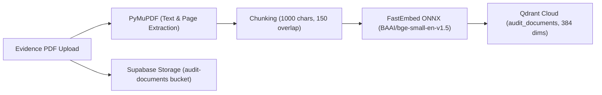

# Vector RAG Pipeline — Ingestion & Assessment

The retrieval-augmented generation (RAG) pipeline grounds all AI assessments in verifiable document excerpts.

---

## 1. Document Ingestion Pipeline



1. **Extraction**: `PyMuPDF` extracts clean unicode text page by page, tracking exact `page_number` offsets.
2. **Chunking**: Text is segmented into chunks of 1000 characters with 150-character sliding overlap to preserve sentence boundaries.
3. **Dense Vectorization**: `fastembed` generates 384-dimensional dense vectors locally using ONNX runtime without external network calls, yielding 0ms latency and high reliability.
4. **Tenant-Indexed Ingestion**: Vectors are upserted into Qdrant collection `audit_documents` alongside metadata payloads (`organization_id`, `audit_id`, `document_id`, `page_number`, `text`). Payload indexes on `organization_id` and `audit_id` guarantee strict tenant boundaries.

---

## 2. Gemini 2.5 Flash Assessment Loop

For each clause in the audit scope:

1. **Query Construction**: Neo4j provides the clause text, title, required evidence types, and audit questions.
2. **Semantic Search**: Qdrant retrieves the top 8 most similar document chunks matching the clause requirement:
   ```python
   Filter(must=[
       FieldCondition(key="organization_id", match=MatchValue(value=org_id)),
       FieldCondition(key="audit_id", match=MatchValue(value=audit_id)),
   ])
   ```
3. **Cognitive Audit**: The clause requirements and evidence chunks are fed into **Gemini 2.5 Flash** with a strict auditor system prompt:
   - Evaluates conformance: `compliant`, `partially_compliant`, `non_compliant`, `needs_review`.
   - Assigns a confidence score (0.00 to 1.00).
   - Identifies specific gaps and missing evidence.
   - Prescribes concrete corrective actions.
4. **Audit Findings & Evidence Linkage**: The assessment is written to `audit_findings` and individual excerpt links are recorded in `audit_evidence`.
